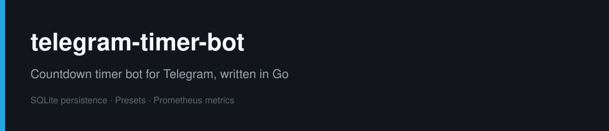
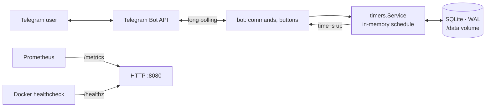

# telegram-timer-bot


Telegram bot for countdown timers, written in Go. Timers are stored in SQLite and survive restarts:
if the bot was down when a timer was due, it fires right after the start with a "late by N min" note.

## Features

- `/timer 25`, `/timer 1h30m Call`, `/timer 1ч 30м чай`: length in English or Russian units, optional label
- `/timers`: active timers with time left and a cancel button for each
- `/preset tea 3m` + `/presets`: saved presets as buttons, one tap starts a timer
- limits: 5 s to 7 days, 20 active timers and 20 presets per chat
- works in groups (`/timer@your_bot`)

## Operations

- **Docker**: multi-stage build, static binary (pure Go SQLite driver, no CGO), distroless `nonroot` image,
  read-only root filesystem, data in a volume, `mem_limit: 64m`
- **Health**: `GET /healthz` checks the database; the image has `HEALTHCHECK` via `timerbot healthcheck`
  (no curl needed in distroless)
- **Metrics**: `GET /metrics` for Prometheus: `timerbot_active_timers`, `timerbot_timers_started_total`,
  `timerbot_timers_fired_total` plus Go runtime metrics
- **Logs**: structured JSON (`log/slog`)
- **Graceful shutdown** on SIGTERM: in-memory timers stop, the database keeps them for the next start
- **CI** (GitHub Actions): gofmt, go vet, tests with the race detector, compose validation, image build, gitleaks secret scan



## Run

```bash
cp .env.example .env          # put the token from @BotFather
docker compose up -d --build
docker compose ps             # STATUS shows (healthy)
curl -s localhost:8080/metrics | grep timerbot_
```

Without Docker:

```bash
TELEGRAM_TOKEN=... go run ./cmd/timerbot
```

| Variable | Default | |
|---|---|---|
| `TELEGRAM_TOKEN` | — | required |
| `TZ` | `Europe/Moscow` | time zone for "fires at 15:04" |
| `DB_PATH` | `timerbot.db` (`/data/timerbot.db` in Docker) | SQLite file |
| `HTTP_ADDR` | `:8080` | health and metrics |

## Project layout

```
cmd/timerbot        entry point: config, HTTP server, graceful shutdown
internal/bot        Telegram commands and inline buttons
internal/timers     scheduling, restore after restart, limits, metrics
internal/store      SQLite storage for timers and presets
internal/duration   parsing "1h30m" / "1ч 30м" / "25"
```

## Tests

```bash
go test -race -cover ./...
```

Covered: duration parsing (including overflow), presets storage, firing and deleting timers,
cancel isolation between chats, per-chat limit, restore of overdue and future timers after a restart.

## License

MIT
